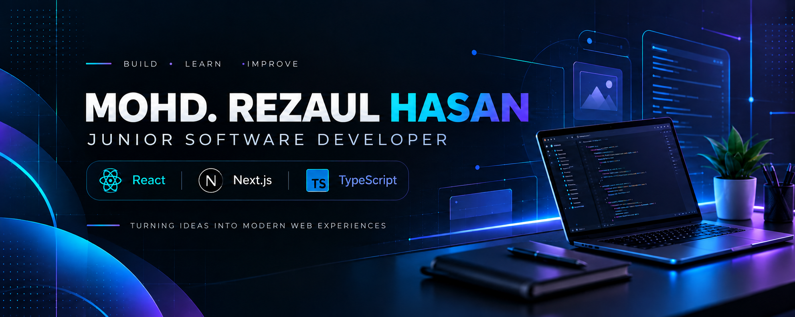

## Hi, I'm Mohd. Rezaul Hasan 👋

**Junior Software Developer** 
**React • Next.js • TypeScript** 
**Full-Stack Development & Application Security**

Welcome to my GitHub profile. I build and learn through hands-on software development projects, with a focus on responsive web applications using React, Next.js, and TypeScript.

## About Me

I'm an Electrical & Electronics Engineering graduate with professional engineering experience, transitioning into software development. I enjoy turning ideas into clean, responsive web experiences while strengthening my understanding of JavaScript, React, Next.js, and TypeScript.

My engineering background and professional experience shape how I approach technical problems: systematically, with curiosity and a desire to understand how systems work.

## Demonstrated Technologies

Technologies and tools used in my hands-on projects and development workflow.

### Web Foundations

### Frameworks & Styling

### Tools & Workflow

### Project-Based Backend Experience

Better Auth and MongoDB — used in BazarDor for authentication and database integration.

## Currently Learning

- Full-Stack Development
- Backend Engineering
- Database Design
- Authentication and Authorization
- Application Security
- Secure Software Development

I'm developing these fundamentals through study and practice, building on the technologies used in my projects.

## Featured Projects

### BazarDor — Assignment 7

A Bengali-first market-price application for browsing grocery prices in Bangladesh, tracking price changes, and exploring market-wise details, with authentication and protected product pages.

**Stack:** Next.js • React • TypeScript • Better Auth • MongoDB • Tailwind CSS

[Repository](https://github.com/rezaulhasan1369/Assignment-7) · [Live Demo](https://bazardor-dps25.vercel.app)

### FitLog — Assignment 6

A learning project for browsing workouts, building a daily workout plan, and saving exercises for later, with plans stored locally in the browser.

**Stack:** Next.js • React • TypeScript • Tailwind CSS

[Repository](https://github.com/rezaulhasan1369/assignment_6) · [Live Demo](https://assignment-6-two-pink.vercel.app/)

### Dev Stack Builder — Assignment Five

A responsive React application for exploring development technologies and building a personalized tech stack, with duplicate prevention and easy stack management.

**Stack:** React • TypeScript • Vite • Tailwind CSS • React-Toastify

[Repository](https://github.com/rezaulhasan1369/react-assignment-five) · [Live Demo](https://earnest-gingersnap-7bad9b.netlify.app/)

## Connect With Me

[LinkedIn](https://www.linkedin.com/in/mohd-rezaul-hasan/) · [GitHub](https://github.com/rezaulhasan1369) · [Email](mailto:rezaulhasan1369@gmail.com)
